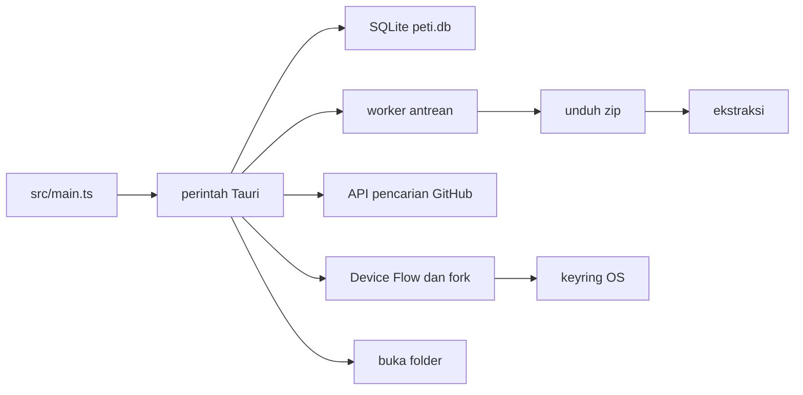

# Arsitektur

Peti adalah aplikasi Tauri 2. Antarmuka TypeScript memanggil perintah di proses Rust. Tidak ada server HTTP milik Peti.

## Proses

`src-tauri/src/lib.rs` membuka `peti.db` di direktori data aplikasi, membaca client id, lalu menjalankan worker antrean di thread terpisah. Worker mengambil baris `menunggu` selama jumlah yang `berjalan` belum mencapai `concurrency`.

Jendela memuat Vite saat pengembangan (`http://localhost:1420`) dan `dist/` saat build. Izin jendela di `src-tauri/capabilities/default.json`: `core:default` dan `dialog:allow-open`. `csp` di `tauri.conf.json` adalah `null`.

## Data

Tiga tabel, dibuat di `src-tauri/src/store.rs`:

- `queue`: `id`, `owner`, `repo`, `git_ref`, `dest`, `status`, `bytes`, `total`, `error`, `folder`.
- `history`: `id`, `owner`, `repo`, `git_ref`, `folder`, `finished_at`.
- `settings`: satu baris `id = 1`.

`finished_at` berbentuk `YYYY-MM-DD HH:MM:SS UTC`, misalnya `2026-10-15 12:00:00 UTC`. History diurutkan `id DESC`.

Status antrean: `menunggu`, `berjalan`, `dijeda`, `selesai`, `gagal`, `dibatalkan`.

Kolom basis data yang ada tidak memuat token, secret, atau kata sandi. Tes `schema_has_no_token_column` mengunci itu.

## Jaringan

Unduhan membangun `https://github.com/{owner}/{repo}/archive/{ref}.zip`. Ref kosong menjadi `HEAD`. Pengalihan: HTTPS 443, host `github.com` atau `codeload.github.com`, tanpa userinfo, paling banyak 5.

Discover memanggil `https://api.github.com/search/repositories` tanpa autentikasi. Query selalu berisi `is:public` dan `created:>=YYYY-MM-DD`. Bahasa dan topik ditambahkan hanya jika tokennya lolos pemeriksaan. Urutan `stars` menurun, `per_page` 20. Header `x-github-api-version` pada pencarian adalah `2022-11-28`. Cache memori 60 detik. User-Agent `Peti/0.1.0`.

Batas ukuran isi respons pencarian dan login adalah 1.000.000 byte. Batas deklarasi zip adalah 8 GiB. Target symlink di dalam zip dibatasi 4096 byte dan harus tetap di dalam tujuan.

## GitHub

Device Flow:

1. `POST https://github.com/login/device/code` dengan client id dan scope `public_repo`.
2. Pengguna membuka `https://github.com/login/device`.
3. `POST https://github.com/login/oauth/access_token` dengan grant `urn:ietf:params:oauth:grant-type:device_code`.
4. `GET https://api.github.com/user` untuk login.

Fork memakai `POST /repos/{owner}/{repo}/forks` dan `GET /repos/{owner}/{repo}` di `api.github.com`, dengan header `x-github-api-version: 2026-03-10`. Tidak ada client secret di kode.

Token tidak ditulis ke SQLite. Keyring memakai layanan `app.peti`.

## Batas yang sudah terbukti

- Unduhan bersamaan 1–8, bawaan 3. Tidak ada kontrol angka di Settings.
- Nama tujuan bentrok dinaikkan sampai `-1000`, lalu gagal.
- Repositori duplikat yang masih `menunggu` atau `berjalan` tidak diantrekan lagi.
- Baris `berjalan` saat proses dibuka ulang menjadi `gagal` (`ditutup saat berjalan`).
- Library menyembunyikan folder hilang, bukan direktori, atau symlink, tanpa menghapus baris history.
- Pencarian dan login tidak mengikuti pengalihan ke host lain.
